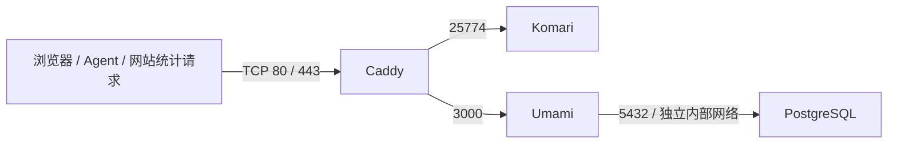

# VPS Monitoring Stack

用 Docker Compose 部署 **Komari + Umami + PostgreSQL + Caddy**：VPS 资源监控、网站访问统计与自动 HTTPS。

## 一条命令启动安装向导（推荐）

在 Ubuntu / Debian VPS 的 SSH 终端执行（需已有 curl）：

```bash
curl -fsSL https://raw.githubusercontent.com/zangwp/vps-monitoring-stack/main/install.sh -o /tmp/vps-monitoring-install.sh && sudo bash /tmp/vps-monitoring-install.sh
```

随后按提示输入：Komari 域名、Umami 域名、邮箱、端口模式和证书方式。脚本安装依赖、在没有 Docker 时通过官方 apt 源安装 Docker、下载项目到 `/opt/vps-monitoring-stack`、生成随机密钥并启动服务。重复运行保留数据库密码和应用密钥；重新配置域名/端口前请先备份，地址变更后同步更新 Agent 和网站统计脚本。使用已有 Docker 时要求它有 Compose v2，并且服务可以连接。

证书选项：

1. **自动 HTTPS**：适用于公网 80 或 443 可用并正确指向本实例，无需填写证书文件。
2. **Cloudflare DNS 自动证书**：适用于 80/443 已被占用或使用随机高位端口。在终端输入 Cloudflare API Token（隐藏输入，保存于权限 0600 的 `.env`），Caddy 自动申请并续期。Token 对所需域名区域授予 `Zone:Read` 和 `DNS:Edit` 权限；脚本构建带 DNS 插件的 Caddy，首次构建需要时间和内存。参见 [插件官方说明](https://github.com/caddy-dns/cloudflare)。
3. **已有证书**：在终端输入两个域名的证书链和私钥路径，脚本复制到项目证书目录；续期由你现有的证书工具负责。

DNS 的 A/AAAA 记录仍需先在域名服务商处指向 VPS。Cloudflare 模式只管理证书验证 TXT 记录，不改你的网站解析；随机高位端口通常需要 DNS 直连，Cloudflare 代理不支持任意端口。脚本打印应放行的真实端口，不自动修改云安全组、现有防火墙或 SSH 配置。首次使用仍需在浏览器完成 Komari 初始化和修改 Umami 默认密码。

后面的章节提供手动部署和运维说明；使用向导无需逐段执行。

这是个人部署模板，不是上游软件的官方发行版。Komari 负责服务器监控；Umami 负责网站访问统计。网站主动探测、故障告警需要另行配置 Komari 的相应功能或专门的可用性监控服务。

## 架构



只有 Caddy 发布主机端口。部署脚本自动检测并保存空闲端口，数据库只连接 Umami；应用仍可出网。HTTP 自动跳转到 HTTPS，Caddy 原生代理 WebSocket。配置不启用 HTTP/3，所以无需开放 UDP 443。

### 自动检测和随机端口

VPS 需要安装 `python3`。默认 `PORT_MODE=auto` 优先使用 80/443，冲突时从 10000–49999 随机选空闲 TCP 端口。希望一开始就使用高位端口，可设置 `PORT_MODE=random`，并保持 `HTTP_PORT=auto`、`HTTPS_PORT=auto`。也支持填写具体端口，脚本会检查是否被占用。

脚本检查 IPv4/IPv6 绑定和正在运行的 Docker 容器端口映射；端口确定后保存到 `.env`，升级不会重新随机。已保存的端口若被其他服务抢占，脚本报错，不会偷偷改变 URL；需要重新选择时将对应值改回 `auto`。检测与 Docker 启动之间存在时间间隔，其他进程仍可能抢占，最终以 Docker 绑定结果为准。

非标准 HTTPS 端口访问形如 `https://komari.example.com:23456`。部署脚本打印真实地址；Agent 服务端地址和 Umami 统计脚本地址也要带该端口。云安全组和防火墙需要放行选定端口，CDN 可能不支持任意高位端口。

**证书条件：** 至少有公网 80 或 443 正确指向本栈时，可使用默认 ACME 验证（若只保留其中一个标准端口，另一种验证可能先失败再回退）。两者都被占用且没有入口转发时，需要通过 DNS 验证预先签发证书，保存到 `certs/komari/fullchain.pem`、`certs/komari/privkey.pem` 和 `certs/umami/` 下的同名文件；脚本自动改用 `Caddyfile.manual`。缺少证书时停止部署并提示，不会降级为明文 HTTP。手动证书需要独立续期并在更新后重启 Caddy；证书和私钥不提交到 Git，恢复到新 VPS 时须另外准备。更方便的替代方案是复用已有入口代理提供 HTTPS。

### 与其他项目共用 VPS 时的端口

| 服务 | 容器内端口 | 发布到主机 | 会否与其他项目冲突 |
| --- | --- | --- | --- |
| Caddy | 选定 HTTP / HTTPS 端口 | 对应 TCP 端口 | 自动检测避免已占用端口 |
| Komari | 25774 | 无 | 容器网络内使用，不占用主机同号端口 |
| Umami | 3000 | 无 | 容器网络内使用，不占用主机同号端口 |
| PostgreSQL | 5432 | 无 | 容器网络内使用，不占用主机同号端口 |

不同 VPS 之间端口互不影响。同一 VPS 上的 WordPress、OpenLiteSpeed、Nginx、网站面板或其他 Caddy 很可能已经占用了 80/443。部署前在目标 VPS 检查：

```bash
sudo ss -ltnp '( sport = :80 or sport = :443 )'
docker ps --format 'table {{.Names}}\t{{.Ports}}'
```

已有网站时建议复用唯一的入口反向代理，让不同域名转发到不同应用。需要修改此模板：移除本栈 Caddy 服务；若代理运行在宿主机，将 Komari 和 Umami 分别映射到空闲的回环端口（例如 `127.0.0.1:12577:25774` 和 `127.0.0.1:13000:3000`），由已有代理提供 HTTPS，并保留 Komari 的 WebSocket 支持。若入口代理也在 Docker 中，可以加入共用 Docker 网络并直接访问应用容器，不必发布应用端口。数据库始终不发布端口。移除 Caddy 后，部署脚本中的 Caddy 验证步骤也需要同步调整。

这里的回环端口只是例子，使用前仍需确认空闲。高位端口模式的证书条件见上文；共用入口代理仍然是同机多网站部署的推荐方式。

## 相比原教程的改进

- 随机生成数据库密码、`APP_SECRET` 和 2FA 加密密钥；实际 `.env`、数据和备份不会进入 Git。
- 使用明确镜像版本，避免 `latest` 无意触发跨版本升级；仍需定期审查补丁并更新版本。更严格的复现可将镜像设置为 `image@sha256:...`。
- PostgreSQL 就绪后再启动 Umami；添加 Umami 健康检查与日志大小限制。
- PostgreSQL 用 `pg_dump` 备份；Komari 停止后归档完整数据目录，避免在线复制 SQLite/WAL 和 PostgreSQL 数据目录。
- 去掉直接改管理员数据库的步骤，使用当前初始化向导；不假定容器包含 sqlite3。
- 补充 Agent 安装、网站统计接入、迁移与恢复说明。

## 1. 准备 VPS

适用于 Debian 12 / Ubuntu 22.04、24.04 等安装了 Docker Engine 与 Compose v2 的 Linux VPS。建议从 2 GB 内存起步，实际需求取决于节点、流量和保留时间；这不是实测最低配置。

按 [Docker Debian](https://docs.docker.com/engine/install/debian/) 或 [Docker Ubuntu](https://docs.docker.com/engine/install/ubuntu/) 官方步骤安装 Docker。确认下面命令可执行；所有命令使用同一个有 Docker 权限的账号。

```bash
docker version
docker compose version
sudo ss -ltnp '( sport = :80 or sport = :443 )'
```

如果已有网站、Nginx、面板或 Caddy 占用端口，可以使用自动检测的高位端口并准备证书，或复用现有代理，避免直接停掉业务服务。

DNS 为 `komari.你的域名` 和 `umami.你的域名` 设置指向 VPS 的 A 记录。存在 AAAA 记录时也必须指向可访问的 IPv6。首次部署建议使用 DNS 直连，后续使用 CDN 时检查真实 IP 与证书配置。

在云安全组放行 TCP 80/443 和实际 SSH 端口；启用 UFW 前先放行当前 SSH 端口，并保留当前 SSH 会话检查新连接。Docker 发布端口的流量处理与 UFW 普通规则不同，不能单靠 UFW 判断端口是否公开。参见 [Docker 防火墙说明](https://docs.docker.com/engine/network/packet-filtering-firewalls/)。

## 2. 配置和部署

```bash
git clone https://github.com/zangwp/vps-monitoring-stack.git
cd vps-monitoring-stack
bash scripts/init.sh
nano .env
bash scripts/deploy.sh
```

修改 `.env` 中的邮箱、两个域名即可。脚本不会覆盖已有 `.env`，生成的密码为十六进制，不需要连接 URL 转义。不要将密码改成包含 `@`、`:`、`/` 等字符的原文，除非同步处理 URL 编码。生产环境不要运行会输出密码的 `docker compose config`，使用 `--quiet`。

镜像基线：Komari 1.5.1、Umami 3.4.0、Caddy 2.10.2、PostgreSQL 15.14。以 `.env.example` 为准；本模板使用 PostgreSQL 15 数据路径，不适用于直接替换为 PostgreSQL 18 的布局。

部署脚本验证 Compose/Caddy 配置并等待容器启动。它不会安装 Docker、改防火墙或 DNS，也不会自动替你创建应用管理员。

**首次部署及时完成初始化。** Komari 使用首次访问向导创建管理员；Umami 默认登录 `admin / umami`，登录后立即修改密码，建议启用 2FA。对于面向公网的新实例，初始化期间在云安全组将 TCP 443 限制为你的管理 IP，完成后再开放；TCP 80 保持可供 ACME HTTP 验证。不要在 Umami 整个域名前加登录鉴权，否则网站统计脚本也会被拦截。

访问：`https://你的Komari域名` 和 `https://你的Umami域名`。

### 接入服务器和网站

1. 在 Komari 后台添加服务器，在对应 VPS 执行后台生成的 Agent 安装命令；包括监控面板所在的 VPS 本身。确认安装命令中的服务器地址使用 HTTPS，Agent token 不要提交到仓库。
2. 在 Umami 后台添加网站，将后台给出的统计脚本放到网站页面中。检查网站 CSP 允许该域名的 `script-src`、`connect-src`。
3. 打开网站产生真实访问，在 Umami 查看数据；在 Komari 检查 CPU、内存和连接状态。容器运行成功不代表数据采集已经接通。

## 3. 日常维护

```bash
docker compose ps
docker compose logs --tail 100 komari
docker compose logs --tail 100 umami
docker compose logs --tail 100 caddy
```

健康检查只标记健康状态，不会自动重启不健康但仍运行的进程。`unless-stopped` 会在进程退出后重启，手动停止后保持停止。

升级前阅读上游发行说明，先备份，再修改 `.env` 的镜像版本并运行部署脚本。`pull` 相同固定版本通常不会升级到下一版本。不要直接把已有 Umami 2.x 切成 3.x，先遵循官方迁移说明；数据库结构迁移后，单纯降级镜像通常不能回滚，应恢复旧备份和旧镜像。

不要直接改已有 PostgreSQL 的 `.env` 密码：数据库初始化后，修改环境变量不会修改数据库角色密码。需要先在数据库中改密码，再同步应用连接配置。

## 4. 备份

```bash
bash scripts/backup.sh
```

执行账号需要读取 Komari 数据目录权限，可在必要时使用 `sudo bash scripts/backup.sh`。备份期间 Komari 暂停采集；Umami 保持在线，数据库逻辑备份为一致性快照。失败时脚本尝试重新启动 Komari，检查 `docker compose ps` 确认恢复。

备份目录包含 PostgreSQL dump、Komari 数据、配置、实际 `.env` 和校验和。仅带 `COMPLETE` 的目录代表整个流程成功。dump 目录检查和归档校验不能代替实际恢复演练。证书没有备份，恢复后由 Caddy 重新签发；重复恢复会受 ACME 限流影响。

备份含密钥、服务器信息和网站数据，请加密保存到 VPS 外。默认不自动清理旧备份，定期检查磁盘空间。

## 5. 恢复到新 VPS

以下流程只用于**新的空实例**；生产恢复前另做现有数据备份。先把完整备份放到新 VPS，比如 `/srv/restore/backup`，并安装 Docker、复制本项目。配置中的镜像应与备份一致。

```bash
cd /srv/restore/backup
test -f COMPLETE
sha256sum -c SHA256SUMS
cd /srv/vps-monitoring-stack
# 目标目录必须是新实例；不要在运行中的旧实例执行。
cp /srv/restore/backup/.env /srv/restore/backup/compose*.yaml /srv/restore/backup/Caddyfile* .
chmod 600 .env
mkdir -p data
test ! -e data/komari
test ! -e data/postgres
sudo tar -xzf /srv/restore/backup/komari.tar.gz -C data
docker compose up -d --wait --wait-timeout 120 umami-db
docker compose exec -T umami-db pg_restore -U umami -d umami --no-owner --no-privileges --exit-on-error < /srv/restore/backup/umami.dump
bash scripts/deploy.sh
```

恢复后更新 DNS，并验证两个管理后台、Agent 重连、历史数据和新的网站访问。这里假定 Komari 使用默认本地存储；自定义外部数据库或插件外部存储需要独立备份。

## 6. 从旧教程迁移

先保持旧镜像版本备份，停止旧 Compose 服务再迁移。旧 `komari-data` 对应新 `data/komari`；旧 PostgreSQL 应使用 `pg_dump` 导出并恢复到新空实例。旧的在线 tar 备份不保证可恢复。

不要让旧新实例同时写同一数据目录。保留原项目名和配置用于回滚。迁移、数据库版本升级与 Umami 大版本升级分开做，每一步验证后再继续。

## 排查

| 现象 | 检查 |
| --- | --- |
| Caddy 端口冲突 | `ss` 检查实际占用进程，不要盲目停止已有网站 |
| HTTPS 失败 | A/AAAA、云安全组、主机规则、CDN、Caddy 日志 |
| Umami 不健康 | 应用日志、数据库健康状态、连接密码、磁盘空间 |
| Komari 暂未就绪 | 首次初始化/迁移向导；不要沿用旧版本默认账号假设 |
| 网站没有统计 | 统计 ID、CSP、广告拦截插件、浏览器网络请求 |
| Agent 离线 | 节点网络、HTTPS 地址、token 和 Agent 日志 |

## 验证范围和来源

GitHub Actions 检查 Bash/ShellCheck、初始化不覆盖配置、Compose 解析与 Caddy 配置。它不连接真实域名、不恢复真实备份、不模拟 Agent 与网站统计。正式使用前在测试 VPS 完成 HTTPS、采集和恢复演练。

上游资料（整理日期：2026-10-08）：[Komari Docker](https://komari-document.pages.dev/install/docker)、[Komari releases](https://github.com/komari-monitor/komari/releases)、[Umami 配置](https://docs.umami.is/docs/environment-variables)、[Umami Docker Compose](https://github.com/umami-software/umami/blob/v3.4.0/docker-compose.yml)、[Umami releases](https://github.com/umami-software/umami/releases)、[PostgreSQL pg_dump](https://www.postgresql.org/docs/15/app-pgdump.html)、[Caddy reverse_proxy](https://caddyserver.com/docs/caddyfile/directives/reverse_proxy)。
